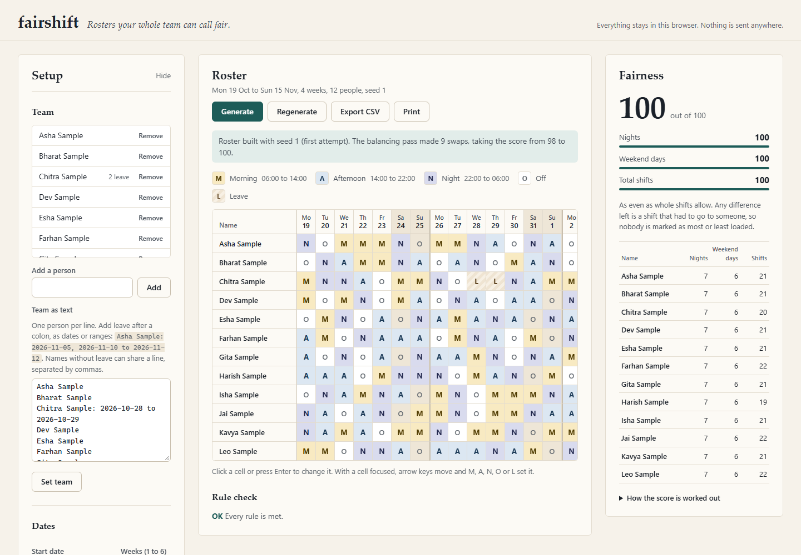
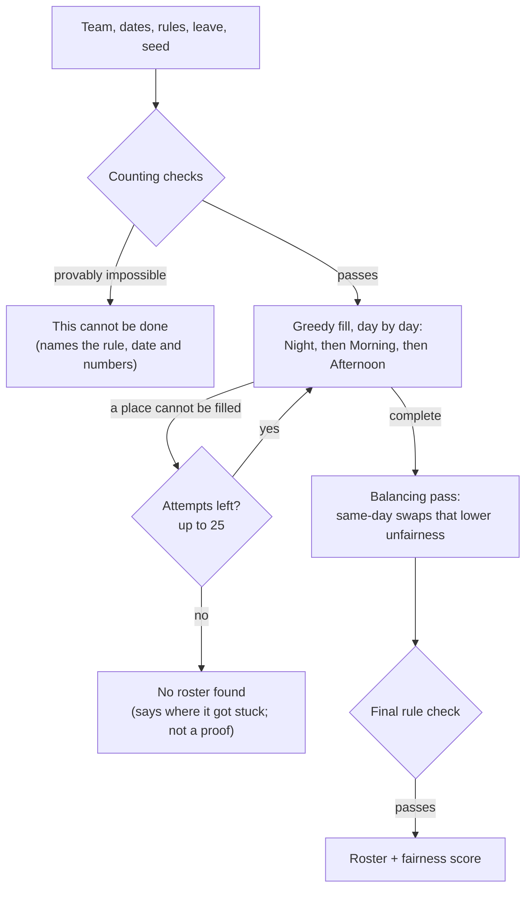
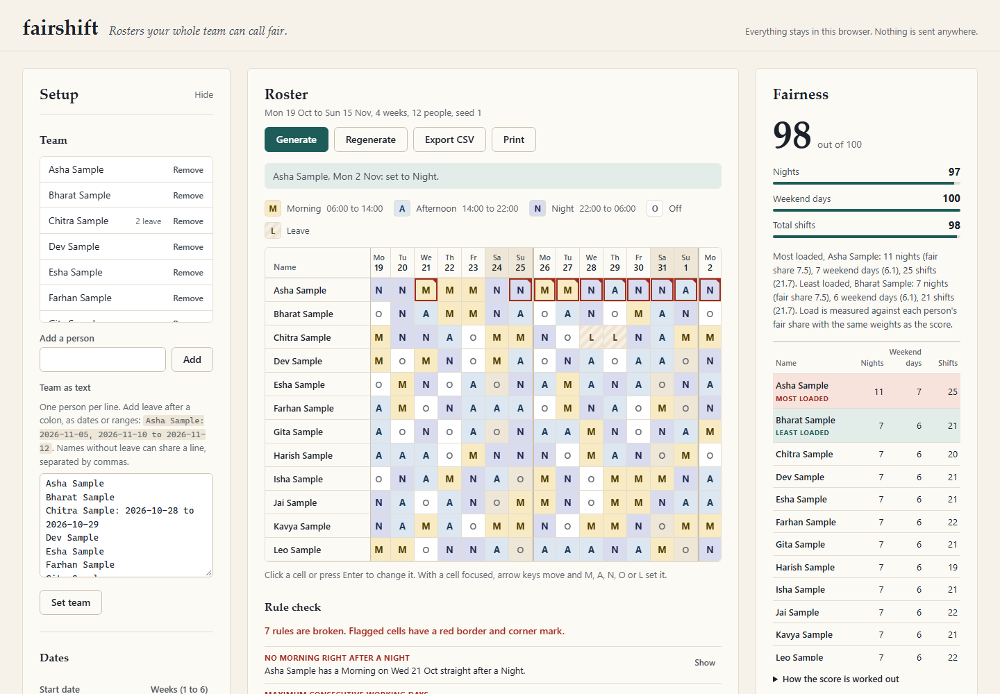

# fairshift

**Rosters your whole team can call fair.**

[](https://github.com/Omkar210404/Fair-Shift/actions/workflows/ci.yml)

**Live demo:** https://omkar210404.github.io/Fair-Shift/#sample (opens with the sample team loaded)

Shop-floor supervisors build shift rosters by hand in Excel, so night shifts and weekends end up unevenly spread and nobody can prove it either way. fairshift builds a roster under rules you set, flags any rule that breaks, and shows a fairness score per person, so the result can be explained.



*The sample team (12 made-up names, 4 weeks, three people on leave for a few days). Taken from the running app.*

## Use it in 3 steps

1. **Set up.** Enter the team, dates, shift times and rules on the left. Each section changes only when you press its Set button, and a bad line is reported with its line number instead of being skipped. Or press **Load sample team**.
2. **Generate.** Press **Generate**. You get a roster that meets every rule, or a plain message saying which rule cannot be met. **Regenerate** tries a different seed.
3. **Check and share.** Click any cell to change it (or focus it and type M, A, N, O or L). Broken rules are flagged on the cell and listed under the grid. **Export CSV** for a spreadsheet, or **Print** for the notice board (A4 landscape, up to 6 weeks on one page).

### Input format for the team

One person per line. Leave goes after a colon, as single dates or ranges:

```text
Asha Sample
Bharat Sample: 2026-11-05, 2026-11-10 to 2026-11-12
Chitra Sample, Dev Sample, Esha Sample
```

Names without leave can share a line, separated by commas. Before a roster exists you can also click a cell to mark leave; the team text updates to match.

### Rules you can set

| Rule | Default | Range |
|---|---|---|
| Minimum people per shift each day (Morning, Afternoon, Night) | 2, 2, 2 | 0 to 50 each |
| Maximum working days in a row | 6 | 1 to 14 |
| Maximum nights in a row | 3 | 1 to 14 |
| No Morning right after a Night | on | on or off |
| At least one day off each week | on | on or off |

Leave is always respected. A leave day counts as a day off for the weekly-off and days-in-a-row rules. Weeks are 7-day blocks from the start date, and Saturday and Sunday are the weekend.

## How the roster is built



**1. Counting checks.** Before searching, fairshift checks what can be proven impossible by simple counting: a team smaller than one day's crew; a date where too many people are on leave; more shifts needed than the team can work once weekly offs, the days-in-a-row limit and leave are taken out (worked out exactly per person); not enough people for Nights under the nights-in-a-row limit; and a Night crew that cannot take the next Morning under the rest rule. If any of these holds, the app says **"This cannot be done"** and names the rule.

**2. Greedy fill.** Days are filled in order. On each day, Night is filled first because it has the most rules attached, then Morning, then Afternoon. For each place, fairshift lists the people who can take it without breaking a rule, and picks the one who has done the least of that kind of work so far: fewest nights for a Night, fewest weekend days on a weekend, then fewest shifts overall. Counts are scaled by the days each person is available, so leave is not held against anyone. Two small look-aheads avoid common dead ends: Night keeps enough people free for the next Morning places, and when a week is running out of days off, people still owed theirs are kept off. Ties are broken by a seeded random number generator.

**3. Retries.** If a place cannot be filled, the attempt is dropped and a new one starts with a different tie-break order from the same seed. Every other retry prefers keeping last night's crew on Nights, and later retries add a little randomness to the order. There are up to 25 attempts.

**4. Balancing pass.** For every day and every pair of people with different letters that day, fairshift swaps the two letters if both people still pass every rule and the unfairness number goes down. A same-day swap never changes how many people are on each shift, so staffing stays correct. It repeats until no swap helps, or 50 rounds.

**5. Final check.** The finished roster goes through the same rule checker that flags manual edits. A roster that breaks a rule is never returned.

The same inputs and seed always give the same roster. Each shift is staffed with exactly the minimum you set; everyone else is off.

## The fairness score

Three things are counted per person: **nights**, **weekend days worked**, and **total shifts**.

- **Fair share.** The team's total is split in proportion to the days each person could work (days not on leave). With no leave, that is the team average. Weekend shares use available weekend days.
- **Gap.** For each of the three, add up how far every person is from their fair share. Shifts come in whole numbers, so some gap cannot be avoided: 85 nights among 12 people means someone does 8. That unavoidable part, the gap of the best whole-number split, is not counted.
- **Part score** = 100 x (1 - remaining gap / team total), never below 0.
- **Overall score** = 40% nights + 40% weekend days + 20% total shifts, rounded. 100 means as even as whole shifts allow.

**Most and least loaded** are the people furthest above and below their fair share, using the same weights. When the score is 100, nobody is marked, because any remaining difference is a shift that had to go to someone.

The balancing pass lowers the same weighted gap, so the pass and the score always agree.



*After giving Asha Sample four of her days off as extra Nights by hand: seven rule warnings appear on the cells and in the list, and she is marked most loaded. Taken from the running app.*

## Results from real runs

All numbers below come from running the code in this repo. Nothing is estimated.

**Sample team** (12 people, 4 weeks, 3 per shift, a few leave days, seed 1): found on the first attempt. The greedy fill scored 98, and the balancing pass made 9 swaps and raised it to 100. Every rule is met. At 6 weeks it is also found on the first attempt, with a score of 100.

**Sweep over 1,000 random setups** (`node tools/sweep.js`; 3 to 22 people, 1 to 6 weeks, 0 to 3 per shift, random limits, rest rule and weekly day off on):

| Outcome | Count |
|---|---|
| Roster found | 844 |
| Proven impossible by the counting checks | 150 |
| Not found by the heuristic | 6 |
| Found rosters that broke a rule | 0 |

Found rosters scored a median of 100 and a lowest of 92. The balancing pass raised the rounded score in 197 of the 844. The slowest single run took 37 ms in Node 22 on an ordinary Windows laptop.

**Not found does not mean impossible.** An example checked by hand: 7 people, 3 on Morning and 3 on Night every day, no Afternoon shift, at most 3 nights and 6 days in a row. A perfectly staggered 7-day rotation (Off, 3 Mornings, 3 Nights) solves it, but a day-by-day greedy fill cannot see that coming. Enter that setup in the app and it says "No roster found", says where it got stuck, and says this is not proof.

## Run it locally

You need a browser. To run the tests or the sweep you also need Node 20 or later. There is nothing to install: no dependencies, no build step.

```bash
git clone https://github.com/Omkar210404/Fair-Shift.git
cd Fair-Shift
python -m http.server 8000      # or any static file server
# open http://localhost:8000/  (add #sample to start with the sample team)
```

Opening `index.html` straight from your disk does **not** work in Chrome or Edge. Both were tested: they block ES module scripts on `file://` pages. The page then shows a note saying so instead of a blank screen. Use the live demo or a local server.

```bash
node --test            # 38 tests, Node's built-in runner
node tools/sweep.js    # the 1,000-setup sweep above
```

The tests cover minimum staffing, the rest rule, both days-in-a-row limits, the weekly day off, leave, same seed giving the same roster, clear failures for impossible inputs, the fairness score (100 when even, lower when lopsided, leave-adjusted shares, the unavoidable-gap rule), the balancing pass never lowering the score, the CSV format and formula-safe names, dates across month ends, and the team text format.

## Privacy and safety

- All data stays in your browser. The page's Content Security Policy sets `connect-src 'none'`, so it cannot send anything anywhere. It loads no fonts, scripts or images from other sites.
- **Remember on this device** saves to this browser's localStorage only. It is off by default, and unticking it removes the saved copy. If the browser blocks storage, the app still works and says nothing will be kept.
- **Do not enter real personal data on a shared or public computer.** The sample names are made up and all end in "Sample".
- CSV export protects names that start with `=`, `+`, `-` or `@`, so a spreadsheet does not run them as formulas.

## Limitations

- **It is a planning aid, not a compliance tool.** fairshift does not check labour law (for example Factories Act working-hour limits). The limits are whatever you enter. Check them against the rules that apply to your site.
- **It is a heuristic.** It does not search every possible roster, so it does not promise the fairest roster that exists. It can also miss a roster that exists (about 0.6% of the random sweep). It never breaks a rule to cover that up.
- **The score averages over the whole team.** One person far over their share moves it less than you might expect: in the edited screenshot above, Asha Sample has 11 nights against a fair share of 7.5, and the overall score is still 98. Always read the "Most loaded" line and the per-person table, not just the number.
- **Staffing is exactly the minimum.** Each shift gets exactly the number you enter and everyone else is off. There is no "working days per week" target.
- **No memory between rosters.** A Night worked the day before the start date is not seen, so the rest rule and the limits restart at each roster.
- **Fixed calendar choices.** Weekends are Saturday and Sunday; weeks are 7-day blocks from the start date. There are three shift types plus Off and Leave.
- **Shift times are labels only.** They are shown in the key and on the printout and are not used in any rule.
- **Size limits.** 1 to 6 weeks and up to 50 people. Printing fits one A4 page for a 6-week roster of 12 people; a much larger team runs onto more pages.

## Project structure

```text
index.html          page, Content Security Policy, all labels
styles/app.css      screen styles: colour tokens, layout, grid
styles/print.css    A4 landscape notice-board print
src/roster.js       all roster logic, no DOM: dates, team format, rules, generate, fairness, CSV
src/app.js          state, rendering, events, picker, keyboard
src/storage.js      optional localStorage, every call wrapped in try/catch
src/sample.js       the made-up sample team
tests/              node --test suite for roster.js
tools/sweep.js      the reproducible 1,000-setup sweep
.github/workflows/  CI (tests on Node 20 and 22) and the Pages deploy
```

## License

MIT. See [LICENSE](LICENSE).
